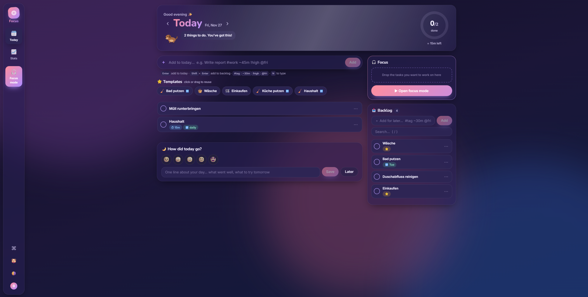
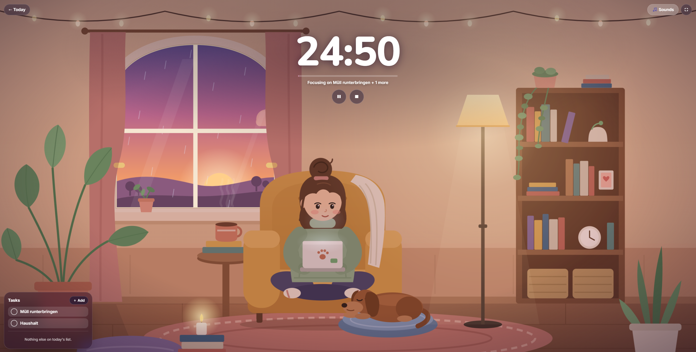

# Focus

A cozy, modern todo app: plan **today** from your backlog, reuse the todos you do all the time, work through them in a full-screen lofi **Focus Mode**, and see how many of your plans actually got done.





- **Frontend:** Angular 22 (standalone components, signals, zoneless), Angular CDK drag & drop, ECharts, installable PWA
- **Backend:** ASP.NET Core 10 minimal APIs, clean-architecture solution (Api / Application / Domain / Infrastructure)
- **Storage:** SQLite via EF Core, one database with per-user data
- **Accounts:** email + password, with cookie sign-in that lasts (see [Accounts & sign-in](#accounts--sign-in))

## Features

- **Today**: your list for the day, a progress ring, a dog mascot that reacts to your progress, and confetti when you finish things.
- **Backlog**: everything for later. Drag tasks between the backlog and the day, and reorder by dragging.
- **Templates**: save any task as a template (⋯ → *Save as template*). Click or drag a template to create a fresh copy.
- **Repeating tasks**: in a task's editor pick *Repeat*: daily or every N days, weekly on chosen weekdays (e.g. every Monday, every other Friday), or monthly on a day (the 1st, the 15th, the last day). On those days the task lands on **Today** by itself when you open the app. An unfinished copy goes back to the backlog as usual and comes back on the next repeat day instead of piling up. Repeating tasks show 🔁 and live on as templates on the shelf; set *Repeat → Never* (or delete the template) to stop them.
- **Due dates**: set in the editor or with `@today`, `@tomorrow`, `@fri`, `@nextweek`, `@24.12` in quick add. Overdue tasks get a red badge, and the backlog has a "Due soon" filter.
- **Quick add**: `Write report #work ~45m !high` sets the tag, estimate and priority. Press <kbd>Enter</kbd> for the day or <kbd>Shift</kbd>+<kbd>Enter</kbd> for the backlog.
- **Focus Mode**: an original animated lofi scene (a girl with brown hair and her little brown dog) that follows the time of day.
  - Drop tasks into the focus tray and pick a duration.
  - Ambient sound and lofi music, generated live in the browser.
  - Keyboard: <kbd>Space</kbd> pause, <kbd>F</kbd> full screen, <kbd>M</kbd> sound.
- **Checklists**: break a task into steps in the editor (drag to reorder). Tick steps off right on the card or in Focus Mode; when every step is done you're offered to complete the task. Templates keep their checklist, so "Laundry" always comes with *wash, dry, fold*.
- **Command palette**: <kbd>Ctrl</kbd>+<kbd>K</kbd> (<kbd>⌘</kbd>+<kbd>K</kbd> on a Mac) or the ⌘ button. Jump anywhere, find a task and complete / move / edit / focus it, type `fri` or `24.12` to go to that day, or type any text to add it as a task (<kbd>Shift</kbd>+<kbd>Enter</kbd> for the backlog).
- **End-of-day reflection**: a mood and one line about your day, at the bottom of Today (opens by itself in the evening, or press <kbd>R</kbd>). Reflections show in the Stats journal and the calendar tooltips.
- **Installable & offline-friendly**: install it from the browser or the ⌘ palette. The production build caches the app and your most recent data, so it opens and shows your last plan without a network or server (changes need a connection). A toast offers a reload when a new version is ready.
- **Morning ritual**: unfinished tasks go back to the backlog overnight. On first open you get yesterday's recap and a one-click "bring back to today".
- **Stats**: daily completion rate (done ÷ planned), streaks, focus minutes, a 26-week heatmap and insights.
- **Themes**: light, dark or automatic, and six colour themes from the 🎨 button (or <kbd>Ctrl</kbd>+<kbd>K</kbd>): *Daylight* (the default, gradients shift from sunrise to night), *Sunset*, *Ocean*, *Forest*, *Berry* and *Paper*. The stats charts follow the theme colours.
- **Dog or cat**: the 🐶/🐱 button above the theme toggle switches your companion everywhere: the Today mascot, the morning ritual and Focus Mode.

Other keyboard shortcuts on Today: <kbd>N</kbd> quick add, <kbd>/</kbd> search backlog, <kbd>←</kbd>/<kbd>→</kbd> change day, <kbd>T</kbd> back to today, <kbd>R</kbd> reflect. <kbd>Ctrl</kbd>+<kbd>K</kbd> works everywhere.

## Prerequisites

- .NET SDK 10
- Node.js ≥ 22.22 (or ≥ 24.15)

## Development

Run the API and the Angular dev server in two terminals:

```bash
# Terminal 1: API on http://localhost:5080 (creates backend/src/Focus.Api/App_Data/focus.db)
cd backend/src/Focus.Api
dotnet run

# Terminal 2: frontend on http://localhost:4200 (proxies /api to the backend)
cd frontend/focus-web
npm install
npm start
```

The OpenAPI document is at `http://localhost:5080/openapi/v1.json` in development.

## Accounts & sign-in

Everyone signs in, and each account only sees its own tasks, templates, tags, focus sessions and reflections. Data from before accounts existed goes to the **first account created**.

- **Email + password**: "Create an account" on the sign-in page.
- **You stay signed in**: the sign-in cookie lasts a year and renews itself while you use Focus, so you only sign in again after a year without opening the app, or after signing out. The keys that protect the cookie are stored in `backend/src/Focus.Api/App_Data/keys` (change with `DataProtection__KeysPath`), so restarting or redeploying the server doesn't sign anyone out. Keep that folder when you move the database. An installed app opened offline stays signed in as the last user.
- Sign-in attempts are limited to 10 per minute per client address.

## Production / single process

`ng build` writes the app into the API's `wwwroot`, so one process serves both the app and the API:

```bash
cd frontend/focus-web && npx ng build
cd ../../backend/src/Focus.Api && dotnet run
# open http://localhost:5080 and use the browser's "Install app" button for the PWA
```

The service worker is only active in production builds. The database location can be changed with the `ConnectionStrings__Focus` environment variable, for example `Data Source=D:\data\focus.db`.

## Tests

```bash
cd backend && dotnet test             # unit tests (planning history, stats, quick add, checklists, reflections, repeating tasks, per-user data) + API integration tests (incl. sign-in)
cd frontend/focus-web && npx ng test  # Vitest unit tests
```

## Database migrations

```bash
cd backend
dotnet tool restore
dotnet ef migrations add <Name> -p src/Focus.Infrastructure -s src/Focus.Infrastructure -o Persistence/Migrations
# works while the API is running (it doesn't build the API project)
```

Migrations are applied automatically on startup.
